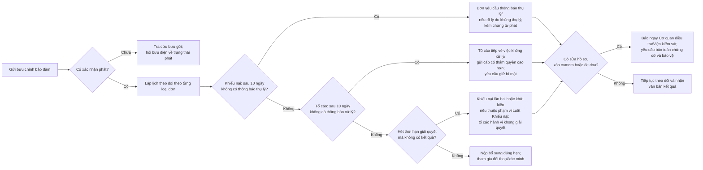

# Sơ đồ ứng xử khi nghi ngờ bị ghi sai kết quả khám sức khỏe NVQS

> Tài liệu hướng dẫn thực hành, cập nhật theo các văn bản tra cứu được tại ngày
> **05/11/2026**. “Bùa BMI” là cách gọi không chính thức trong thực tế, không
> phải thuật ngữ pháp lý. Tài liệu này không kết luận một cá nhân hay cơ quan đã
> vi phạm; chỉ hướng dẫn cách bảo toàn chứng cứ, yêu cầu kiểm tra và dùng đúng
> kênh khiếu nại, tố cáo hoặc tố giác.

## 1. Quy tắc ngắn gọn

1. **Vẫn đi khám và chấp hành giấy gọi hợp lệ.** Khiếu nại hoặc tố cáo không tự
   động làm mất hiệu lực giấy gọi. Nếu muốn tạm dừng việc thi hành một quyết
   định, phải yêu cầu người có thẩm quyền xem xét biện pháp tạm đình chỉ; không tự
   ý bỏ khám hoặc không có mặt.
2. **Yêu cầu sửa ngay tại nơi phát sinh.** Khi phát hiện sai chiều cao, cân nặng,
   BMI, thị lực, độ kính hoặc điểm, nói rõ yêu cầu đo/khám lại và yêu cầu ghi
   nhận bằng văn bản.
3. **Không ký giấy trống, giấy chưa được giải thích hoặc giấy “tự nguyện” khi
   mình không tự nguyện.** Tuy nhiên, không ký giấy tự nguyện không đồng nghĩa
   được từ chối khám hoặc được miễn nghĩa vụ quân sự.
4. **Tách đúng mục tiêu:** đề nghị đo/giám định để sửa kết quả; khiếu nại để
   bảo vệ quyền lợi trước quyết định hoặc hành vi hành chính; tố cáo để yêu cầu
   xử lý người có hành vi vi phạm nhiệm vụ, công vụ; tố giác/tin báo tội phạm khi
   có dấu hiệu đưa, nhận hối lộ, giả mạo, làm sai lệch hồ sơ hoặc hành vi tội phạm
   khác.
5. **Chỉ nêu điều mình biết và có căn cứ.** Viết “nghi có dấu hiệu…” kèm thời
   gian, vị trí, người chứng kiến và tài liệu; không khẳng định “móc nối” nếu chưa
   có chứng cứ.

## 2. Sơ đồ xử lý tổng thể

```mermaid
flowchart TD
    A[Nhận giấy gọi sơ tuyển hoặc khám sức khỏe] --> B[Đọc toàn bộ giấy tờ<br/>ghi lại ngày, nơi khám, cơ quan ký, người giao]
    B --> C{Có giấy hoặc mục ghi<br/>'tự nguyện' không?}

    C -- Không --> D[Tiếp tục chuẩn bị hồ sơ sức khỏe<br/>và chấp hành giấy gọi]
    C -- Có và thật sự tự nguyện --> E[Chỉ ký sau khi đọc, được giải thích<br/>và giữ bản sao/chụp lại]
    C -- Có nhưng không tự nguyện --> F[Không ký đơn tự nguyện<br/>yêu cầu giải thích và lập ghi nhận riêng]
    F --> G[Không tranh cãi hoặc bỏ khám<br/>vẫn chấp hành phần bắt buộc]

    D --> H[Chuẩn bị chứng cứ trước ngày khám]
    E --> H
    G --> H

    H --> H1[CCCD, giấy gọi, bệnh án, đơn kính,<br/>kết quả khám cũ, thuốc đang dùng]
    H --> H2[Khám độc lập nếu cần:<br/>đo chiều cao, cân nặng, BMI, mắt/thị lực]
    H --> H3[Lập danh mục tài liệu,<br/>scan/ảnh sao lưu, ghi người chứng kiến]

    H1 --> I[Đến đúng thời gian, địa điểm]
    H2 --> I
    H3 --> I

    I --> J[Trong từng bàn khám: quan sát và ghi lại<br/>giờ, phòng, máy đo, chỉ số, điểm, lý do, người khám]
    J --> K{Chỉ số hoặc điểm có dấu hiệu sai?}

    K -- Không --> L[Tiếp tục khám đủ quy trình<br/>và theo dõi phần kết luận]
    K -- Có --> M[Nói ngay: đề nghị đo/khám lại<br/>và ghi đúng kết quả thực tế]
    M --> N{Họ đo/khám lại và sửa hoặc<br/>ghi nhận đầy đủ?}
    N -- Có --> O[Lấy bản sao hoặc chụp kết quả<br/>nếu được phép; ghi thời điểm]
    N -- Không --> P[Yêu cầu lập biên bản/phiếu ghi nhận<br/>việc đề nghị đo lại nhưng không được đáp ứng]
    P --> Q[Ghi họ tên/chức vụ hoặc mô tả người từ chối;<br/>người chứng kiến; không tự sửa phiếu]

    J --> R{Phiếu để trống điểm,<br/>lý do hoặc chưa kết luận?}
    R -- Không --> S[Kiểm tra phần kết luận:<br/>chiều cao, cân nặng, BMI/thị lực, phân loại,<br/>chữ ký và dấu theo mẫu]
    R -- Có --> T[Yêu cầu ghi điểm, lý do và chữ ký;<br/>nếu nghi ngờ chưa kết luận được, yêu cầu chuyển khám chuyên khoa]
    T --> U{Vẫn bỏ trống hoặc từ chối ghi nhận?}
    U -- Có --> V[Ghi lại câu trả lời, thời gian, nhân chứng;<br/>gửi đề nghị bằng văn bản ngay sau buổi khám]
    U -- Không --> S

    L --> S
    O --> S
    Q --> S
    V --> S

    S --> W{Đã được cung cấp bản sao,<br/>ảnh hoặc văn bản kết quả?}
    W -- Có --> X[Lưu bản gốc và bản sao;<br/>không chỉnh sửa file ảnh/video]
    W -- Không --> Y[Yêu cầu bằng văn bản bản sao/trích lục;<br/>xin xác nhận đã tiếp nhận]

    X --> Z[Đối chiếu với hồ sơ độc lập<br/>và tính toán lại chỉ số]
    Y --> Z
    Z --> AA{Sai sót là nhầm lẫn có thể sửa<br/>hay có dấu hiệu cố ý/bao che?}

    AA -- Nhầm lẫn hoặc chưa đủ căn cứ --> AB[Đề nghị sửa phiếu, khám lại,<br/>giám định sức khỏe; gửi kèm chứng cứ]
    AA -- Có dấu hiệu vi phạm nhiệm vụ --> AC[Tố cáo hành vi và người thực hiện;<br/>yêu cầu giữ bí mật thông tin người tố cáo]
    AA -- Có dấu hiệu tội phạm --> AD[Tố giác/tin báo tội phạm tới<br/>Cơ quan điều tra hoặc Viện kiểm sát có thẩm quyền]

    AB --> AE{Đã có quyết định gọi nhập ngũ<br/>hoặc quyết định/hành vi hành chính ảnh hưởng trực tiếp?}
    AC --> AE
    AD --> AE
    AE -- Chưa --> AF[Theo dõi thông báo công khai,<br/>yêu cầu cơ quan có thẩm quyền xử lý trước khi chốt danh sách]
    AE -- Có --> AG[Đồng thời khiếu nại đúng người ban hành/<br/>người quản lý hành vi; yêu cầu xem xét tạm đình chỉ nếu có nguy cơ khó khắc phục]

    AB --> AH[Theo dõi bằng mã bưu gửi,<br/>phiếu nhận, thông báo thụ lý và thời hạn]
    AC --> AH
    AD --> AH
    AF --> AH
    AG --> AH

    AH --> AI{Đến hạn mà không xử lý,<br/>không thông báo hoặc có dấu hiệu sửa hồ sơ?}
    AI -- Không --> AJ[Tham gia xác minh/đối thoại;<br/>nộp bổ sung theo yêu cầu và nhận kết quả bằng văn bản]
    AI -- Có --> AK[Đơn đôn đốc và tố cáo việc không giải quyết;<br/>khiếu nại lần hai/khởi kiện nếu đủ điều kiện;<br/>báo ngay cơ quan điều tra nếu có dấu hiệu tội phạm]
```



## 3. Phân biệt bốn loại văn bản nên dùng

| Mục tiêu | Tên nên dùng | Nội dung chính | Gửi đến đâu |
| --- | --- | --- | --- |
| Sửa một chỉ số vừa đo sai, xin được xem/cấp bản sao, xin đo lại | **Đơn đề nghị/kiến nghị** | Chỉ số thực tế, thời gian, yêu cầu đo lại, hoàn chỉnh phiếu, cấp bản sao | Người phụ trách điểm khám, Chủ tịch Hội đồng khám sức khỏe khu vực, Hội đồng NVQS cấp xã hoặc Ban chỉ huy phòng thủ khu vực |
| Yêu cầu đánh giá lại sức khỏe theo thủ tục chuyên môn | **Đơn đề nghị giám định sức khỏe** | Dùng Mẫu 8; nêu nội dung cần giám định; kèm phiếu sức khỏe | Hội đồng NVQS cấp xã hoặc Ban chỉ huy phòng thủ khu vực để đề nghị Hội đồng giám định y khoa cấp tỉnh |
| Bảo vệ quyền, lợi ích của chính mình trước quyết định/hành vi hành chính | **Đơn khiếu nại** | Quyết định/hành vi bị khiếu nại, lý do, chứng cứ, yêu cầu hủy/sửa/chấm dứt/giải quyết lại | Lần đầu: người đã ra quyết định hoặc cơ quan có người thực hiện hành vi; cấp trên trực tiếp khi khiếu nại lần hai |
| Yêu cầu xử lý người có hành vi vi phạm nhiệm vụ, công vụ | **Đơn tố cáo** | Người/hành vi bị tố cáo, thời gian, địa điểm, cách thức, chứng cứ, yêu cầu giữ bí mật | Người đứng đầu cơ quan quản lý trực tiếp người bị tố cáo; nếu là Chủ tịch/Phó Chủ tịch UBND cấp xã hoặc người thuộc cấp tỉnh thì theo thẩm quyền cấp tỉnh |
| Có dấu hiệu hối lộ, giả mạo, làm sai lệch hồ sơ hoặc tội phạm khác | **Tố giác/tin báo về tội phạm** | Dữ kiện tội phạm, người liên quan, chứng cứ, nguy cơ mất chứng cứ | Cơ quan điều tra hoặc Viện kiểm sát có thẩm quyền; cơ quan nhận tố cáo hành chính phải chuyển nếu nhận thấy dấu hiệu tội phạm |

Không phải mọi sai số đo đều chứng minh được “cố ý làm sai”. Nếu chưa có chứng cứ về ý chí cố ý, nên dùng **đơn đề nghị sửa/giám định** và **khiếu nại** trước; chỉ tố cáo phần hành vi mà mình có dữ kiện cụ thể.

## 4. Trước ngày khám: chuẩn bị hồ sơ và kế hoạch chứng cứ

### 4.1. Bộ hồ sơ nên chuẩn bị

Giữ bản gốc ở nhà; khi nộp chỉ nộp bản sao, bản sao chứng thực hoặc bản in có
đối chiếu khi cơ quan yêu cầu:

- CCCD và giấy gọi sơ tuyển/khám sức khỏe/quyết định gọi nhập ngũ;
- bệnh án, giấy ra viện, kết quả xét nghiệm, đơn thuốc, hồ sơ bệnh mạn tính;
- đơn kính, kết quả đo khúc xạ, phiếu khám mắt và kính đang sử dụng;
- các kết quả khám độc lập gần ngày khám, trong đó ghi ngày giờ, chỉ số, kết luận,
  tên bác sĩ, chữ ký và dấu của cơ sở khám;
- một bản tường trình theo dòng thời gian: đến lúc nào, khám ở bàn nào, ai đo,
  chỉ số được đọc/ghi ra sao, mình đã yêu cầu điều gì và họ trả lời gì;
- danh sách người chứng kiến, số điện thoại và việc họ trực tiếp nhìn thấy/nghe
  thấy; không yêu cầu họ xác nhận điều họ không trực tiếp biết;
- bản scan/ảnh toàn bộ tài liệu và danh mục phụ lục có đánh số trang.

### 4.2. Ví dụ tính chỉ số

Nếu đo được **1,70 m và 45 kg**, BMI theo công thức `cân nặng / chiều cao²`
là khoảng **15,6 kg/m²**. Đây là phép tính để phát hiện chênh lệch và yêu cầu đo
lại; nó **không tự thay thế** việc áp dụng bảng tiêu chuẩn sức khỏe hiện hành.
Kết luận đủ/không đủ sức khỏe còn phụ thuộc cách đo, các chỉ tiêu khác, bệnh tật,
phân loại và kết luận của Hội đồng theo phụ lục của Thông tư áp dụng.

### 4.3. Gửi yêu cầu trước ngày khám

Nếu đã có bệnh án hoặc chỉ số bất thường, có thể gửi trước một văn bản ngắn đến
Ban chỉ huy quân sự cấp xã/Hội đồng NVQS cấp xã và đề nghị:

1. ghi nhận hồ sơ bệnh tật trước khi lập phiếu;
2. bố trí đo/khám đúng nội dung chuyên môn;
3. cho phép ghi nhận yêu cầu của công dân trong biên bản nếu có bất đồng;
4. hướng dẫn thủ tục giám định nếu sau khám có khiếu nại về sức khỏe.

Đơn trước ngày khám là **đề nghị bảo đảm thủ tục**, không thay thế việc có mặt
theo giấy gọi.

## 5. Trong sơ tuyển và khám sức khỏe: cần quan sát gì?

### 5.1. Đo thể lực

- Một số địa phương gọi các đợt hoặc khu vực khám là “vòng 1/vòng 2”. Khi làm
  hồ sơ, hãy ghi theo đúng tên trên giấy gọi, phiếu và biên bản; đừng mặc định
  rằng cách gọi tại địa phương tạo ra một thủ tục khiếu nại riêng. Điều quan
  trọng là xác định ngày, nơi, Hội đồng và kết quả của từng lần.
- Ghi giờ, địa điểm, số thứ tự, bàn khám và người thực hiện nếu biết.
- Quan sát chỉ số được đọc lại và ghi vào phiếu. Nếu chiều cao/cân nặng khác xa
  thực tế hoặc kết quả độc lập, nói ngay: “Tôi đề nghị đo lại và ghi kết quả đo
  thực tế vào phiếu/biên bản.”
- Không tự ý chỉnh sửa phiếu. Nếu cán bộ không sửa, yêu cầu lập biên bản hoặc
  ghi nhận riêng việc đã đề nghị đo lại nhưng không được đáp ứng.
- Kiểm tra mục thể lực: chiều cao, cân nặng, BMI, vòng ngực và điểm/lý do nếu
  mẫu phiếu có các mục này.

### 5.2. Đo mắt và độ khúc xạ

- Ghi rõ đo thị lực không kính, có kính và độ khúc xạ nếu có yêu cầu/được ghi.
- Nếu kết quả không hợp lý, yêu cầu đo lại đúng kỹ thuật hoặc khám chuyên khoa.
- Không tự làm sai lệch kết quả bằng cách cố tình đọc sai bảng, tháo/lắp kính sai
  hoặc khai bệnh không đúng. Việc bảo vệ quyền lợi phải dựa trên bệnh thật và
  chứng cứ thật.

### 5.3. Điểm, lý do và chữ ký

Theo quy trình của Thông tư 105/2023/TT-BQP đã được sửa đổi bởi Thông tư
106/2025/TT-BQP, sau khi khám từng chuyên khoa, thành viên Hội đồng ghi điểm,
ghi tóm tắt lý do và ký, ghi rõ họ tên; Chủ tịch Hội đồng căn cứ các điểm để ghi
phân loại bằng số và bằng chữ. Trường hợp nghi ngờ, chưa cho điểm hoặc chưa kết
luận được thì Hội đồng phải gửi công dân đi khám chuyên khoa để có kết luận chính
xác, thời gian tối đa 10 ngày trong trường hợp cần thiết.

Vì vậy, nếu **bỏ trống điểm/lý do/chưa kết luận**:

1. yêu cầu người phụ trách ghi rõ đây là chưa kết luận hay đã kết luận;
2. đề nghị ghi điểm, lý do, chữ ký hoặc ghi rõ việc chưa thể kết luận;
3. yêu cầu chuyển khám chuyên khoa nếu còn nghi ngờ;
4. nếu bị từ chối, ghi lại nguyên văn câu trả lời, thời gian, bàn khám, người
   chứng kiến và gửi đơn ngay sau buổi khám.

### 5.4. Kết luận cuối buổi

Kiểm tra tối thiểu các mục sau trước khi rời khu vực khám:

- chiều cao, cân nặng, BMI/thị lực hoặc độ khúc xạ đã được ghi đúng chưa;
- từng chuyên khoa có điểm, lý do và chữ ký theo mẫu chưa;
- phần kết luận có phân loại sức khỏe bằng số và bằng chữ, lý do, chữ ký của Chủ
  tịch Hội đồng và dấu theo mẫu chưa;
- có nội dung nào bị tẩy xóa, viết đè, bỏ trống hoặc ghi khác với lời đọc tại
  bàn khám không.

Không phải lúc nào công dân cũng được giữ **bản gốc** Phiếu sức khỏe NVQS. Theo
quy định quản lý phiếu, trước khi nhập ngũ phiếu được cơ quan quân sự có thẩm
quyền quản lý. Hãy yêu cầu được xem, xin bản sao/trích lục hoặc chụp lại khi
được phép; nếu bị từ chối, gửi yêu cầu bằng văn bản và giữ bằng chứng đã yêu cầu.
Không giật lấy hồ sơ hoặc cản trở việc bàn giao.

## 6. Khiếu nại và giám định: gửi đến đâu?

### 6.1. Giám định sức khỏe theo thủ tục chuyên ngành

Đối với khiếu nại liên quan đến sức khỏe của công dân thực hiện NVQS trước khi
nhập ngũ, Thông tư 105/2023/TT-BQP (đã sửa đổi bởi Thông tư 106/2025/TT-BQP)
quy định Hội đồng giám định y khoa cấp tỉnh thực hiện khi có đề nghị của Hội
đồng NVQS cấp xã hoặc Ban chỉ huy phòng thủ khu vực.

Hồ sơ cốt lõi gồm:

1. đơn đề nghị giám định của cá nhân theo **Mẫu 8 Phụ lục V**;
2. văn bản đề nghị của Hội đồng NVQS cấp xã hoặc Ban chỉ huy phòng thủ khu vực;
3. bản sao hợp lệ Phiếu sức khỏe NVQS, Phiếu kiểm tra hoặc Phiếu phúc tra tùy
   nội dung đề nghị.

Hội đồng giám định y khoa cấp tỉnh phải có kết luận trong **15 ngày kể từ khi
nhận đủ hồ sơ hợp lệ**; quyết định của Hội đồng là kết luận cuối cùng về khiếu
nại sức khỏe của công dân thực hiện NVQS theo thủ tục này. Nếu cơ quan địa phương
không lập văn bản đề nghị, yêu cầu họ trả lời bằng văn bản và lưu việc từ chối
để khiếu nại/tố cáo tiếp.

### 6.2. Khiếu nại hành chính

Khiếu nại phải xác định một **quyết định hành chính hoặc hành vi hành chính**
ảnh hưởng trực tiếp đến quyền, lợi ích của mình. Đơn nên có:

- ngày, tháng, năm;
- họ tên, địa chỉ, số điện thoại người khiếu nại;
- tên cơ quan/người bị khiếu nại;
- quyết định/hành vi, thời gian và địa điểm xảy ra;
- lý do, điều khoản hoặc quy trình bị cho là vi phạm;
- yêu cầu cụ thể: đo/khám lại, sửa phiếu, cung cấp bản sao, hủy/sửa quyết định,
  chấm dứt hành vi hoặc tổ chức giám định;
- danh mục chứng cứ và chữ ký/điểm chỉ.

Nguyên tắc gửi lần đầu là gửi đến **người đã ra quyết định hoặc cơ quan có người
thực hiện hành vi**. Thời hiệu khiếu nại thông thường là 90 ngày kể từ ngày nhận
được hoặc biết được quyết định/hành vi. Nếu đơn thuộc thẩm quyền và đủ điều kiện,
người có thẩm quyền phải thụ lý trong 10 ngày và thông báo bằng văn bản; thời hạn
giải quyết lần đầu thông thường không quá 30 ngày, vụ việc phức tạp không quá 45
ngày. Hết thời hạn hoặc không đồng ý với kết quả, có thể khiếu nại lần hai đến
cấp trên trực tiếp hoặc khởi kiện vụ án hành chính nếu đủ điều kiện.

Các mốc này phải đối chiếu với văn bản sửa đổi hiện hành, đặc biệt Luật
136/2025/QH15 có hiệu lực từ 01/07/2026 và Nghị định 155/2026/NĐ-CP.

## 7. Tố cáo ai và gửi cơ quan nào?

Tố cáo nên ghi **người thực hiện hành vi** nếu biết, đồng thời ghi cơ quan/đơn vị
quản lý họ. Nếu chưa biết tên, không tự đoán hoặc bịa tên; mô tả đủ để cơ quan
định danh từ danh sách trực, sổ phân công, camera, phiếu khám và người chứng kiến.

| Người/hành vi cần xác minh | Địa chỉ chính nên ghi | Ghi chú |
| --- | --- | --- |
| Cán bộ Ban chỉ huy quân sự cấp xã, công chức cấp xã, thành viên Hội đồng NVQS cấp xã do cấp xã quản lý | **Chủ tịch UBND cấp xã** | Ghi rõ chức vụ, ca trực, thời gian; Hội đồng NVQS cấp xã giúp Chủ tịch UBND cấp xã xem xét, giải quyết việc NVQS nhưng không nên ghi chung chung “tố cáo Hội đồng” nếu biết người thực hiện |
| Chủ tịch/Phó Chủ tịch UBND cấp xã hoặc người thuộc thẩm quyền cấp tỉnh | **Chủ tịch UBND cấp tỉnh** theo thẩm quyền hiện hành | Chính quyền địa phương đã chuyển sang mô hình hai cấp; kiểm tra đầu mối tiếp công dân và cơ quan tiếp nhận tại tỉnh |
| Bác sĩ/nhân viên y tế thuộc bệnh viện, trung tâm y tế, trạm y tế hoặc cơ quan y tế | Người đứng đầu cơ quan quản lý trực tiếp; thường là giám đốc cơ sở hoặc **Sở Y tế** tùy đơn vị | Nêu rõ họ tên nếu biết; nếu không, ghi phòng khám, ca, số bàn, mô tả và đề nghị xác minh danh sách phân công |
| Người đứng đầu cơ quan chuyên môn cấp tỉnh hoặc hành vi liên quan nhiều cơ quan | **Chủ tịch UBND cấp tỉnh**, có thể gửi bản để biết đến Thanh tra tỉnh/Sở Y tế | Không coi Thanh tra tỉnh/Sở Y tế là nơi thay thế mọi thẩm quyền; đề nghị phân loại, chuyển đúng nơi và thông báo kết quả |
| Có dấu hiệu nhận/đưa tiền, sửa hồ sơ, giả mạo chữ ký/dấu, tiêu hủy chứng cứ, bao che có dấu hiệu hình sự | **Cơ quan điều tra** hoặc **Viện kiểm sát** có thẩm quyền | Có thể gửi đồng thời tin báo hình sự; nêu nguy cơ mất camera, sổ trực, dữ liệu máy đo và yêu cầu bảo toàn chứng cứ |

Theo Luật Tố cáo, đơn tố cáo phải ghi họ tên, địa chỉ người tố cáo, nội dung và
chữ ký/điểm chỉ. Người tố cáo có quyền yêu cầu giữ bí mật họ tên, địa chỉ, bút
tích và yêu cầu bảo vệ nếu bị đe dọa, trả thù, trù dập. Tố cáo nặc danh thường
không được thụ lý theo quy trình tố cáo vì không đủ thông tin người tố cáo; tuy
nhiên, tài liệu nặc danh có nội dung rõ, kèm chứng cứ kiểm chứng được, vẫn có thể
được cơ quan dùng như nguồn thông tin để kiểm tra theo thẩm quyền. Người gửi
nặc danh không nên kỳ vọng được thông báo kết quả hoặc được áp dụng đầy đủ cơ chế
bảo vệ người tố cáo.

## 8. Nên gửi một hay nhiều cơ quan?

### Cách nên làm

- Chuẩn bị **một bộ hồ sơ gốc**, đánh số tài liệu và lập bảng kê.
- Gửi **một bản chính** đến cơ quan có thẩm quyền chính.
- Gửi bản sao hoặc dòng “đồng kính gửi để biết/phối hợp” cho cơ quan giám sát
  liên quan nếu thật sự cần, ví dụ Sở Y tế, Thanh tra tỉnh hoặc cơ quan quân sự
  cấp trên.
- Nếu có dấu hiệu tội phạm, lập **một đơn tố giác riêng** gửi Cơ quan điều tra
  hoặc Viện kiểm sát; đừng trộn toàn bộ nội dung hình sự vào một đơn khiếu nại
  hành chính dài và không rõ yêu cầu.
- Mỗi cơ quan nhận phải được ghi trong sổ theo dõi riêng: ngày gửi, mã bưu gửi,
  người nhận, nội dung, hạn phản hồi.

### Cách không nên làm

Không gửi hàng loạt cùng một bản đến nhiều nơi với mục đích tạo áp lực, không
gửi đơn cho cơ quan không có thẩm quyền mà không ghi yêu cầu chuyển đơn, và không
gọi một việc vừa là “khiếu nại lần hai” vừa là “đơn mới” nếu chưa phân biệt rõ
quyết định/hành vi nào đang bị yêu cầu xem xét. Gửi nhiều nơi không làm hồ sơ
mạnh hơn; chứng cứ theo thời gian và việc gửi đúng thẩm quyền mới quan trọng.

## 9. Gửi bưu điện và theo dõi việc xử lý

Gửi bưu điện là cách tốt để tạo dấu vết độc lập, nhưng **phiếu gửi không tự
chứng minh cơ quan đã thụ lý**. Nên dùng bưu chính bảo đảm/phát có ký nhận và
lưu:

- biên nhận, mã vận đơn, ảnh phong bì và danh mục tài liệu;
- ảnh hoặc PDF nguyên vẹn của toàn bộ hồ sơ đã gửi;
- kết quả tra cứu phát, tên người ký nhận nếu hệ thống thể hiện;
- mọi cuộc gọi/email sau đó, ghi ngày giờ và nội dung trao đổi;
- văn bản thông báo thụ lý, không thụ lý, chuyển đơn hoặc yêu cầu bổ sung.

Quy trình khi cơ quan đã nhận nhưng im lặng:



Đối với tố cáo, Luật Tố cáo quy định người có thẩm quyền kiểm tra, xác minh và
quyết định thụ lý trong 10 ngày; nếu không thuộc thẩm quyền thì chuyển trong 05
ngày làm việc và thông báo nếu người tố cáo yêu cầu. Thời hạn giải quyết thông
thường là 60 ngày kể từ ngày thụ lý, vụ việc phức tạp là 90 ngày; có thể gia hạn
theo giới hạn luật định. Nếu quá hạn hoặc giải quyết trái pháp luật, thực hiện
**tố cáo tiếp** đến người có thẩm quyền cấp trên, kèm toàn bộ chứng từ gửi trước
đó.

## 10. Không ký “giấy tự nguyện”: hiểu đúng để không tự làm yếu hồ sơ

### 10.1. Nghĩa vụ quân sự và “tự nguyện” không phải một khái niệm

Luật NVQS quy định công dân nam trong độ tuổi thực hiện NVQS có nghĩa vụ phục vụ
tại ngũ; công dân nữ trong thời bình chỉ phục vụ tại ngũ nếu tự nguyện và quân
đội có nhu cầu. Vì vậy, một nam công dân thuộc diện gọi nhập ngũ không cần biến
nghĩa vụ bắt buộc thành “đơn tự nguyện” mới phát sinh nghĩa vụ. Ngược lại, với
trường hợp nữ hoặc trường hợp pháp luật thực sự yêu cầu điều kiện tự nguyện, phải
đọc kỹ nội dung trước khi quyết định.

### 10.2. Bảng xử lý theo loại giấy

| Loại giấy | Có nên ký? | Cách làm an toàn |
| --- | --- | --- |
| Giấy gọi, quyết định, giấy mời | Có thể ký để xác nhận đã nhận nếu nội dung đúng | Chữ ký nhận giấy thường chỉ xác nhận việc giao/nhận, không phải tuyên bố tự nguyện; nếu sai thông tin, ghi ý kiến riêng và xin bản sao |
| Phiếu khai tiền sử bệnh/phiếu khám | Ký sau khi đã đọc và khai trung thực | Yêu cầu sửa sai trước khi ký; không khai bệnh giả, không bỏ bệnh thật |
| “Đơn tự nguyện”, “cam kết tự nguyện” | Chỉ ký nếu thật sự tự nguyện và hiểu hậu quả | Nếu không tự nguyện, nói rõ không đồng ý ký; yêu cầu họ nêu căn cứ pháp lý và lập biên bản việc từ chối ký |
| Phiếu/biên bản còn bỏ trống kết quả | Không ký xác nhận nội dung chưa hoàn chỉnh | Yêu cầu hoàn chỉnh; nếu vẫn bị ép, đề nghị lập biên bản riêng có người chứng kiến |
| Giấy xác nhận đã được giải thích | Chỉ ký khi nội dung giải thích đúng và mình đã hiểu | Có thể yêu cầu ghi rõ câu hỏi, câu trả lời, tài liệu đã được giao; không ký câu “đồng ý tự nguyện” nếu mình không đồng ý |

Nếu không ký một giấy tự nguyện, cơ quan không được biến việc đó thành lý do để
ghi nhận rằng công dân đã tự nguyện. Nhưng việc không ký cũng không tự hủy giấy
gọi khám hoặc quyết định gọi nhập ngũ. Cách đúng là **không ký nội dung tự
nguyện**, đồng thời vẫn có mặt, khám và yêu cầu ghi nhận bằng văn bản.

## 11. Khám độc lập tại Bệnh viện Quân y 175

### 11.1. Khám độc lập để làm chứng cứ

Theo thông tin người dùng cung cấp, fanpage Bệnh viện Quân y 175 hướng dẫn đặt
lịch qua ứng dụng, Zalo hoặc đến trực tiếp; Khoa Dinh dưỡng cho biết có thể khám
dinh dưỡng người lớn, đo và ghi chiều cao, cân nặng, BMI, kèm kết luận. Nội dung
trao đổi mạng xã hội không nên dùng thay cho bảng giá hoặc quy trình chính thức;
hãy xác nhận lại với bệnh viện trước khi đi. Trang chính thức của Bệnh viện 175
hiện công bố hotline **1900 1175**, lịch khám và cổng yêu cầu cung cấp giấy tờ
hồ sơ bệnh án.

Khi đăng ký, có thể nói rõ:

> “Tôi cần khám dinh dưỡng người lớn để đo chiều cao, cân nặng, tính BMI và ghi
> nhận tình trạng dinh dưỡng bằng phiếu kết quả. Tôi cần bản có ngày giờ khám,
> chỉ số cụ thể, kết luận, tên/chữ ký bác sĩ và dấu/xác nhận của bệnh viện nếu
> quy trình bệnh viện cho phép.”

Quy trình thực tế thường gồm:

1. đặt lịch hoặc đến quầy tiếp nhận chính thức;
2. mang CCCD, giấy gọi và hồ sơ bệnh cũ nếu muốn bác sĩ xem xét;
3. đăng ký đúng chuyên khoa/nội dung cần khám, không chỉ nói chung “khám NVQS”;
4. yêu cầu kết quả ghi rõ ngày giờ, chiều cao, cân nặng, BMI, phương pháp/điều
   kiện đo nếu bệnh viện có thể ghi, kết luận của bác sĩ, mã hồ sơ và chữ ký;
5. hỏi quầy tiếp nhận nơi đóng dấu/xác nhận, bản giấy và cách lấy bản điện tử;
6. giữ hóa đơn, phiếu đăng ký, phiếu kết quả, bản scan và dữ liệu điện tử gốc;
7. nếu cần đánh giá mắt, đăng ký thêm chuyên khoa mắt để có thị lực/khúc xạ
   được ghi bằng phiếu chuyên môn riêng.

Một giấy khám dinh dưỡng có dấu của Bệnh viện 175 là **chứng cứ y khoa độc lập
hữu ích**, nhưng tự nó không thay thế Phiếu sức khỏe NVQS hoặc kết luận của Hội
đồng khám sức khỏe khu vực. Để trở thành **giám định sức khỏe NVQS theo thủ tục
chuyên ngành**, vẫn phải đi theo hồ sơ Mẫu 8 và văn bản đề nghị của Hội đồng NVQS
cấp xã/Ban chỉ huy phòng thủ khu vực.

### 11.2. Nếu đã nhập ngũ

Khám phúc tra sức khỏe được thực hiện ngay sau khi giao nhận quân và hoàn thành
trong thời hạn quy định. Nếu khiếu nại sức khỏe sau phúc tra, hồ sơ phải đi qua
**Thủ trưởng đơn vị nhận quân**. Theo Thông tư 105/2023/TT-BQP, Hội đồng giám
định y khoa Bệnh viện Quân y 175 thực hiện cho các đơn vị từ Quân khu 5 trở vào
phía Nam; hồ sơ gồm đơn cá nhân theo Mẫu 8, văn bản đề nghị của chỉ huy đơn vị và
bản sao hợp lệ phiếu sức khỏe/phiếu phúc tra. Không nên tự đi khám rồi coi đó là
kết luận cuối cùng của Quân đội nếu chưa có văn bản đề nghị đúng thủ tục.

## 12. Bộ hồ sơ mẫu để gửi

### 12.1. Đơn đề nghị sửa/đo lại/giám định

```text
CỘNG HÒA XÃ HỘI CHỦ NGHĨA VIỆT NAM
Độc lập - Tự do - Hạnh phúc

ĐƠN ĐỀ NGHỊ GHI NHẬN, ĐO LẠI VÀ CUNG CẤP KẾT QUẢ KHÁM SỨC KHỎE NVQS

Kính gửi: [Chủ tịch Hội đồng khám sức khỏe khu vực / Hội đồng NVQS cấp xã /
Ban chỉ huy phòng thủ khu vực / cơ quan phù hợp]

Tôi là: ...  CCCD: ...  Ngày sinh: ...  Địa chỉ: ...  Điện thoại: ...
Giấy gọi số ... ngày ...; khám tại ... vào lúc ... ngày ...

Nội dung đề nghị:
1. Ghi nhận kết quả tôi trực tiếp quan sát/được đọc tại bàn khám: ...
2. Đo/khám lại các chỉ số: ...
3. Hoàn chỉnh phiếu và cung cấp bản sao/trích lục kết quả cho tôi.
4. Trường hợp chưa kết luận được, đề nghị chuyển khám chuyên khoa theo quy định.
5. Nếu có khiếu nại về sức khỏe, đề nghị hướng dẫn/lập văn bản đề nghị giám định
   theo Mẫu 8 và hồ sơ tương ứng.

Tài liệu kèm theo: [danh mục, số trang].
Tôi cam đoan nội dung trình bày đúng những gì tôi biết và chịu trách nhiệm về
tài liệu cung cấp.

[Địa danh], ngày ... tháng ... năm ...
Người làm đơn
(ký, ghi rõ họ tên)
```

### 12.2. Đơn khiếu nại

Đơn khiếu nại phải tập trung vào **quyết định/hành vi cụ thể** và yêu cầu khắc
phục cụ thể. Không viết chung “khiếu nại việc khám NVQS không công bằng”. Hãy
viết: “khiếu nại hành vi ghi cân nặng … kg tại bàn … vào …, khác với kết quả …;
đề nghị đo lại, sửa phiếu, cung cấp bản sao và tạm đình chỉ việc thi hành quyết
định … cho đến khi xác minh nếu có căn cứ hậu quả khó khắc phục”.

### 12.3. Đơn tố cáo

Đơn tố cáo cần trả lời các câu hỏi: ai làm, làm gì, lúc nào, ở đâu, bằng cách
nào, tài liệu nào chứng minh, ai biết trực tiếp, cơ quan nào quản lý người đó và
nguy cơ nào đang xảy ra. Nếu không biết tên, ghi mô tả định danh và đề nghị cơ
quan xác minh từ sổ phân công, danh sách Hội đồng, dữ liệu máy đo, camera và hồ
sơ gốc. Đánh dấu rõ:

> “Tôi đề nghị giữ bí mật họ tên, địa chỉ, bút tích và thông tin nhận diện của
> người tố cáo; đề nghị thông báo bằng kênh an toàn nếu cần bổ sung.”

Không đăng công khai CCCD, bệnh án, ảnh mặt của cán bộ hoặc người khám, số điện
thoại của người chứng kiến. Chỉ cung cấp cho cơ quan có thẩm quyền và che bớt dữ
liệu không cần thiết khi gửi bản sao.

## 13. Nếu có dấu hiệu “bùa BMI” hoặc làm sai lệch có tổ chức

Hãy lập một bảng đối chiếu thay vì chỉ viết lời tố cáo:

| Thời điểm | Nguồn | Chỉ số/điểm | Ai ghi/đọc | Chứng cứ | Mâu thuẫn cần xác minh |
| --- | --- | ---: | --- | --- | --- |
| Trước khám | Phiếu BV độc lập | 1,70 m; 45 kg; BMI khoảng 15,6 | Bác sĩ ... | Phiếu có mã hồ sơ, ký/dấu | Khác với kết quả tại bàn khám |
| Khám vòng/pha 1 | Phiếu/biên bản | ... | Bàn số ... | Ảnh/nhân chứng | Có đo lại không? |
| Khám vòng/pha 2 | Phiếu sức khỏe | ... | Thành viên Hội đồng ... | Bản sao/trích lục | Điểm/lý do/chữ ký có đầy đủ không? |
| Sau khám | Danh sách công khai/quyết định | ... | Cơ quan ban hành | Ảnh niêm yết, mã văn bản | Có sửa sau thời điểm khám không? |

Nghị định 218/2025/NĐ-CP đã quy định xử phạt hành vi làm sai lệch kết quả phân
loại sức khỏe và hành vi đưa/nhận lợi ích để làm sai lệch kết quả trong trường
hợp nhằm trốn tránh NVQS. Quy định này không có nghĩa mọi chênh lệch đo đạc là đã
có vi phạm; cần chứng minh hành vi, lỗi, người thực hiện và mối liên hệ với kết
quả. Nếu có dữ kiện về tiền, chỉ đạo, sửa hồ sơ hoặc tiêu hủy chứng cứ, gửi thêm
tin báo/tố giác hình sự và yêu cầu bảo toàn dữ liệu ngay.

## 14. Cơ sở pháp lý và nguồn chính thức

- [Văn bản hợp nhất 133/2026/VBHN-LQ-VPQH — Luật Nghĩa vụ quân sự](https://vanban.chinhphu.vn/?docid=219575&pageid=27160): thẩm quyền gọi khám/gọi nhập ngũ, trách nhiệm của Hội đồng NVQS và việc công khai kết quả.
- [Thông tư 105/2023/TT-BQP](https://vanban.chinhphu.vn/?classid=1&docid=209184&pageid=27160) và [Thông tư 106/2025/TT-BQP](https://vanban.chinhphu.vn/?classid=1&docid=215514&pageid=27160&typegroupid=6): tiêu chuẩn, quy trình khám, cách ghi phiếu, khám chuyên khoa khi chưa kết luận, Mẫu 3/Mẫu 4/Mẫu 8 và giám định sức khỏe.
- [Nghị định 218/2025/NĐ-CP](https://chinhphu.vn/?classid=1&docid=214822&pageid=27160&typegroupid=4): xử phạt vi phạm hành chính trong lĩnh vực quốc phòng, cơ yếu, bao gồm vi phạm về khám sức khỏe NVQS.
- [Luật Khiếu nại 02/2011/QH13](https://vanban.chinhphu.vn/default.aspx?docid=162374&pageid=27160) và [Luật 136/2025/QH15](https://vanban.chinhphu.vn/default.aspx?docid=216516&pageid=27160): hình thức, thời hiệu, thẩm quyền và trình tự khiếu nại hiện hành.
- [Luật Tố cáo 25/2018/QH14](https://vanban.chinhphu.vn/?docid=206115&pageid=27160), [Nghị định 156/2026/NĐ-CP](https://vanban.chinhphu.vn/?classid=1&docid=218183&pageid=27160&typegroupid=4): tiếp nhận, thụ lý, thời hạn, bảo mật và bảo vệ người tố cáo.
- [Nghị định 155/2026/NĐ-CP](https://vanban.chinhphu.vn/?classid=0&docid=218102&pageid=27160): sửa quy định chi tiết thi hành Luật Khiếu nại.
- [Nghị định 141/2025/NĐ-CP](https://vanban.chinhphu.vn/?classid=1&docid=213917&orggroupid=2&pageid=27160): phân định thẩm quyền tiếp công dân, khiếu nại, tố cáo trong mô hình chính quyền địa phương hai cấp.
- [Bệnh viện Quân y 175 — trang chính thức](https://web.benhvien175.vn/vi), [lịch khám](https://web.benhvien175.vn/lich-kham-benh) và [cổng yêu cầu hồ sơ](https://web.benhvien175.vn/vi/cong-dich-vu-cong): xác nhận lịch, nơi đăng ký, việc cấp/tra cứu hồ sơ và thông tin liên hệ trước khi đi khám.

### Lưu ý về hiệu lực

Tên cơ quan, đầu mối tiếp nhận và phân công giữa cấp tỉnh/cấp xã có thể được
điều chỉnh. Trước khi gửi, hãy tra trang chính thức của tỉnh, UBND cấp xã, Sở Y
tế hoặc cơ quan quân sự địa phương để lấy **tên người đứng đầu và địa chỉ tiếp
nhận hiện tại**; nếu không chắc thẩm quyền, ghi rõ yêu cầu “tiếp nhận, phân loại,
chuyển đúng thẩm quyền và thông báo cho tôi bằng văn bản”.
